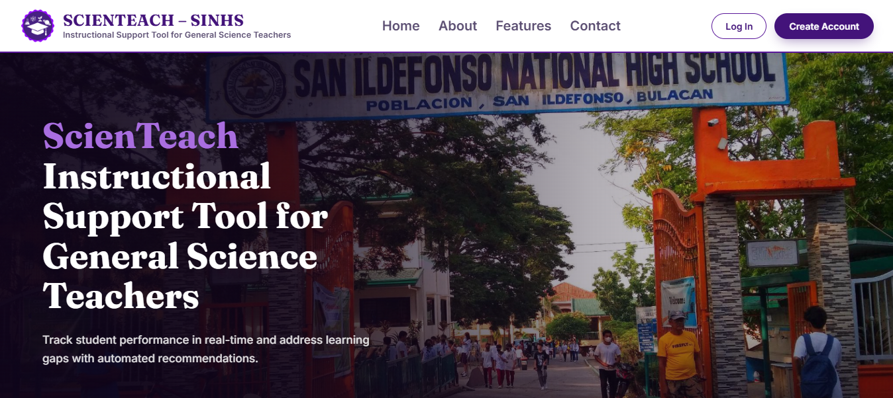
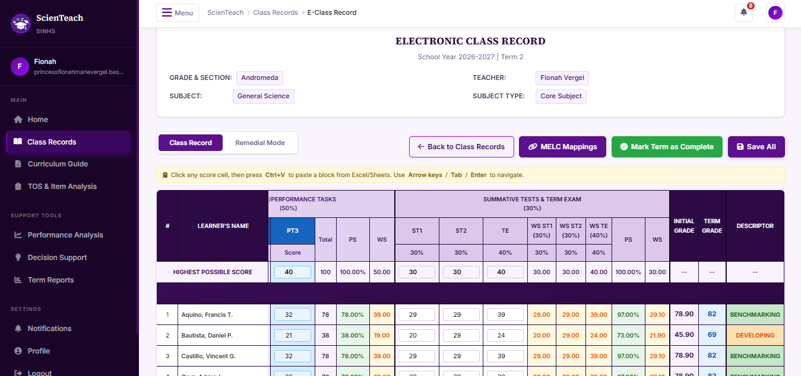
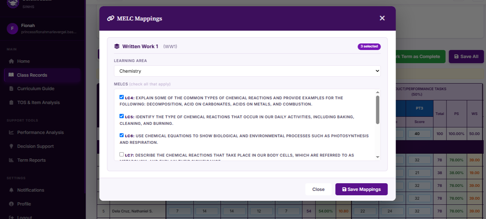
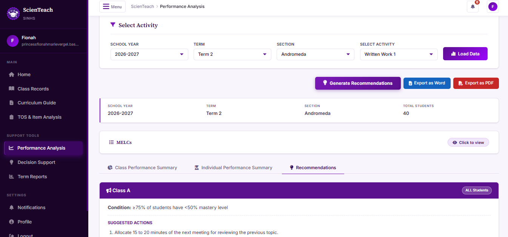
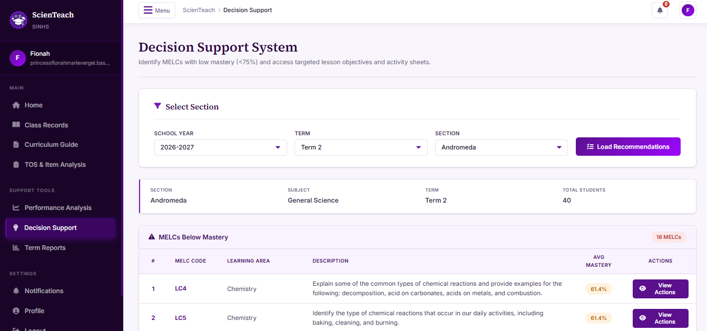
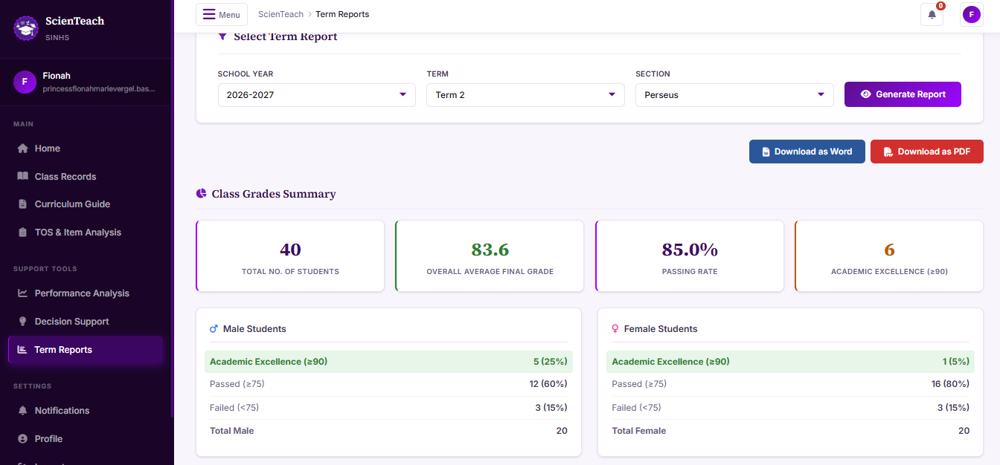

# ScienTeach SINHS Capstone Project

This is a web-based decision support system for General Science senior high school teachers in San Ildefonso National High School (SINHS). It assists in identifying and addressing students' learning gaps through analyzing class record data and generating instructional recommendations, including class-level actions and downloadable activities.

**Website:** [www.scienteach.tech](https://www.scienteach.tech)

## Key Features

### E-Class Record

A fully functional template that replicates the official e-class record administered by DepEd. Teachers will only need to copy and paste data from their spreadsheet file and the template will mirror the calculations for their weighted and transmuted grades. They can also use 'Remedial Mode' to input the students' scores on remedial exams and calculate their improvement score.

Other replicated forms include the Table of Specifications and Item Analysis forms - both tools are used for planning summative tests and term examinations. Like the e-class record, teachers will only need to copy-paste existing data and the form will calculate needed information.

### Score-to-Learning Competency Mapping

The key module that bridges student scores with accurate performance analysis is the Most Essential Learning Competency (MELC) mapping tool. Upon pasting scores to an activity column, a modal with a checklist of learning competencies (MELCs) will appear. Upon checking and saving, the MELCs become linked to the scores in that activity column. Columns with mapped MELCs are highlighted with a light blue and are applied to all other sections automatically.

### Performance Analysis and Recommendations

Performance Analysis is calculated per activity in the e-class record. Results are divided into three main sections: Class Performance Summary, Individual Performance Summary, and Recommendations. 
- Class Performance Summary consists of the students' average, highest and lowest scores and the class' mastery level categories according to reaching the 75% mastery threshold.
- Individual Performance Summary consist of each students' scores and mastery levels.
- Recommendations classifies intervention levels according to the range of learning gaps and scope of students with identified learning gaps. Intervention levels have corresponding suggested actions. For written works and performance tasks, recommendations are intended for the class' next meeting. For summative tests and term examinations, recommendations are intended for preparing students for remedial exams.

### Decision Support

As a Decision Supprt System, this system tracks student performance in real-time. It accumulates scores along with their mapped MELCs within the current academic term. For each selected section, the top 10 MELCs with lowest scores are displayed along with a button to view and download supplementary learning activity sheets.

### Term Reports

Term reports are created when an e-class record is marked as complete. This summarizes the class' academic performance according to their overall grades, highest performing MELCs, how many students needed remediation, and post-remedial exam improvement.

## Tech Stack

| Layer | Technologies |
|---|---|
| **Frontend** | HTML, CSS, JavaScript |
| **Backend** | Python, Flask (framework), NumPy & Pandas (data analysis) |
| **Database** | MySQL |
| **Hosting** | TiDB, Railway |

## My Contributions

**Role:** Project Manager / Backend Developer

- Led the project and managed the system's development alongside the project timeline, from client needs assessment until final deployment
- Authored the system requirements specification, including integration of later revisions by the client and Capstone panelists
- Developed and implemented the algorithms and rulesets for mapping student scores to learning competencies, performance analysis, and equivalent instructional recommendations according to student performance levels
- Monitored and validated the system's alignment with requirements, including accuracy of MELC mapping and retrievel, data analysis' statistical results and genrated recommendations during development and testing

### Experienced Challenges

Our primary challenge was adapting our project and system to the most recent requirements set by the renewed Department of Education (DepEd) Strengthened Senior High School (SHSS) curriculum. Mid-development, we changed the scope of our project and system to deliver the system within the timeframe of our Capstone course. From this experience, we balanced coordination with our stakeholders and respecting their daytime schedules. 

This predicament however, led us to identifying systematic flaws in our initial system and we were able to further refine our system's alignment with user requirements with the least user friction and added workload. Additionally, we restructured our database and added features that allows the system to be adapt to future changes set by DepEd. We were able to define these changes through comparison of our project's previous and current requirements.

### Future Improvements

Future implementations of the system may benefit from utilizing generative AI to create instructional recommendations trained to accurately tailor DepEd learning competency requirements and learning materials with actionable insights.
